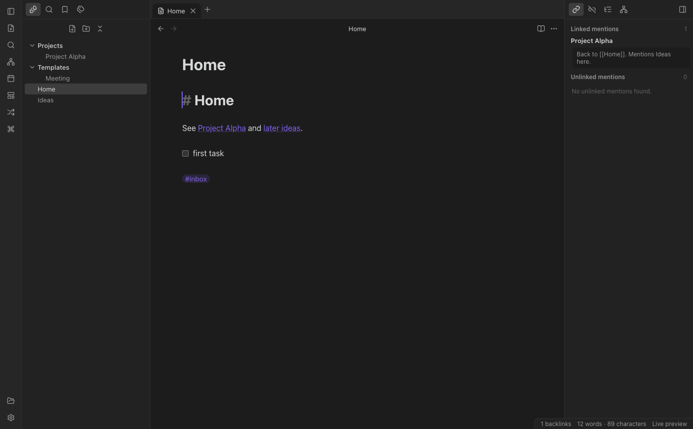
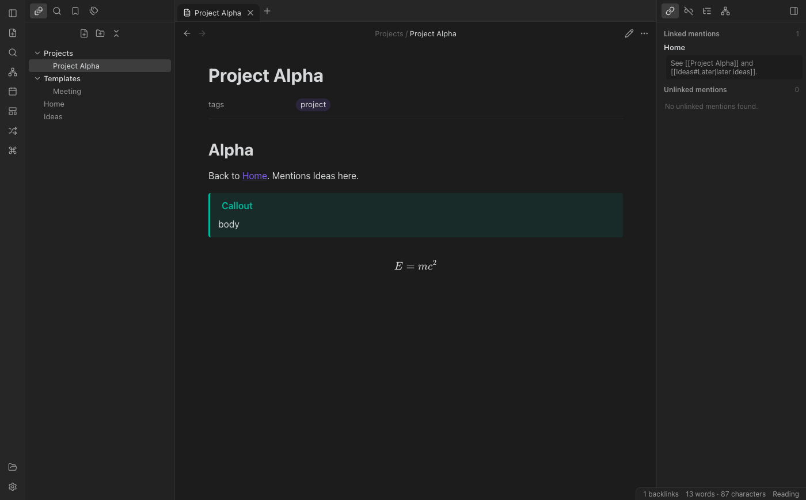
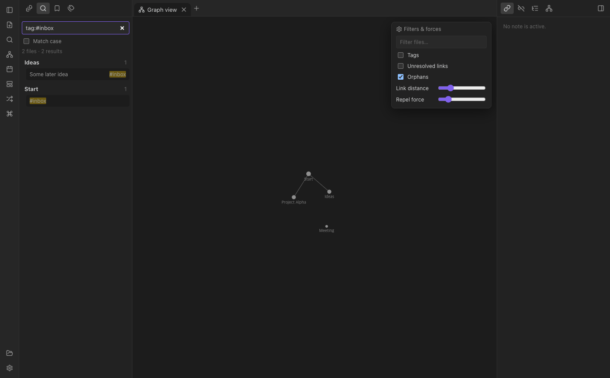
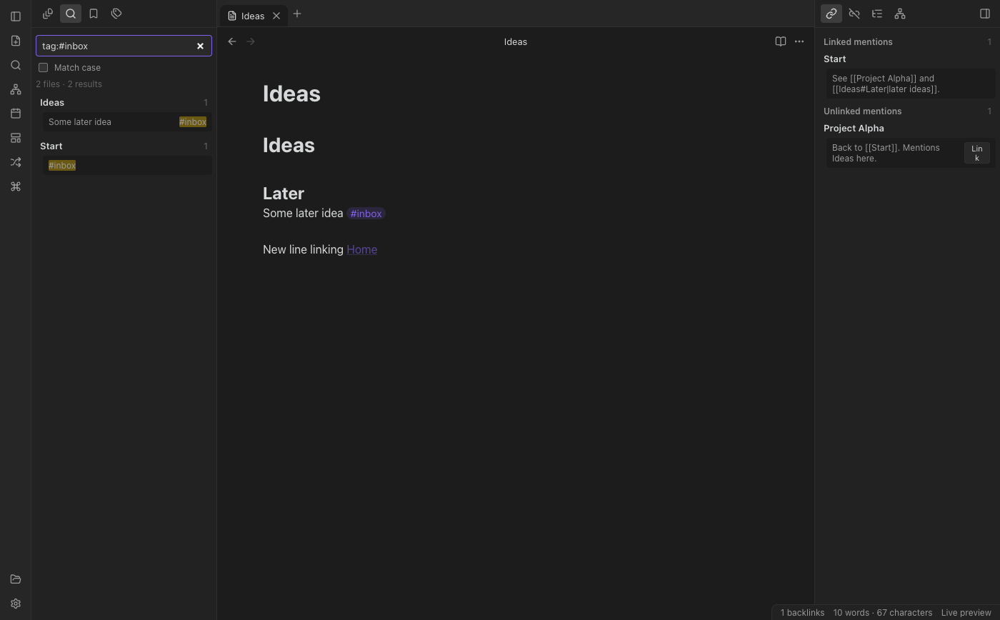

# jjunmo note

A local-first markdown knowledge base for the desktop. Your notes are plain `.md`
files in a folder you own, connected with `[[wikilinks]]`, backlinks, tags and a graph view.



> 마크다운 파일 기반의 로컬 우선 노트 앱입니다. 폴더 하나가 vault가 되고, 노트끼리
> `[[위키링크]]`·백링크·태그·그래프로 연결됩니다. 기존 마크다운 vault(위키링크 문법 사용)도 그대로 열 수 있습니다.

## Features

**Editing**
- Live preview editor (CodeMirror 6) that hides markdown syntax except on the line you are editing
- Source mode and reading view (`Cmd/Ctrl+E`)
- `[[` autocomplete for notes, aliases and headings (`[[Note#Heading]]`), `#` tag autocomplete
- Paste or drop images and files — saved to the attachment folder and embedded as `![[file]]`
- Formatting shortcuts: bold, italic, highlight `==text==`, strikethrough, inline code, checkbox toggle
- Optional Vim key bindings, line numbers and spellcheck

**Markdown**
- Wikilinks with aliases, heading and block references: `[[Note|alias]]`, `[[Note#Heading]]`, `[[Note#^block]]`
- Embeds: notes, note sections, images (with size `![[pic.png|300]]`), PDF, audio and video
- Callouts `> [!tip]` (foldable with `+`/`-`), task lists, GFM tables and strikethrough
- Math with KaTeX (`$inline$`, `$$block$$`), Mermaid diagrams, syntax highlighted code
- YAML frontmatter shown as properties; `tags` and `aliases` are indexed
- `%%comments%%` hidden in reading view

**Navigation & knowledge graph**
- File explorer with drag-and-drop move, rename, delete to trash, duplicate
- Renaming or moving a note updates every link pointing to it
- Backlinks with unlinked mentions (one click to link), outgoing links, outline
- Global graph view and local graph with filters (tags, orphans, unresolved links, depth, forces)
- Full-text search with operators: `tag:#x`, `path:dir`, `file:name`, `"phrase"`, `/regex/`, `-exclude`, `task-todo:`
- Quick switcher (`Cmd/Ctrl+O`, `Shift+Enter` creates), command palette (`Cmd/Ctrl+P`)
- Tabs, split panes, back/forward history, hover preview of links, bookmarks, tag pane

**Workflow**
- Daily notes with a configurable folder, date format and template
- Templates with `{{title}}`, `{{date}}`, `{{time}}`, `{{date:YYYY-MM-DD}}`
- Dark, light or system theme, accent color, font size, readable line length
- Workspace layout (open tabs and splits) restored per vault
- Files changed outside the app are picked up automatically

| Reading view | Graph view | Search |
| --- | --- | --- |
|  |  |  |

## Getting started

Requires Node.js 22 or newer.

```bash
git clone https://github.com/jjunmo/jjunmo-note.git
cd jjunmo-note
npm install
npm run dev        # run with hot reload
```

Other scripts:

| Command | What it does |
| --- | --- |
| `npm run build` | Build main, preload and renderer into `out/` |
| `npm start` | Run the built app |
| `npm test` | Unit tests for parsing, link resolution and link rewriting |
| `npm run test:e2e` | Launch the built app against a temporary vault and exercise the main features (run `npm run build` first) |
| `npm run typecheck` | TypeScript type check |
| `npm run dist` | Package installers with electron-builder (`dist/`) |

## Keyboard shortcuts

| Action | macOS | Windows / Linux |
| --- | --- | --- |
| Quick switcher | `⌘O` | `Ctrl+O` |
| Command palette | `⌘P` | `Ctrl+P` |
| New note | `⌘N` | `Ctrl+N` |
| Search all files | `⌘⇧F` | `Ctrl+Shift+F` |
| Toggle reading view | `⌘E` | `Ctrl+E` |
| Graph view | `⌘G` | `Ctrl+G` |
| Split right | `⌘\` | `Ctrl+\` |
| Close tab | `⌘W` | `Ctrl+W` |
| Navigate back / forward | `⌘⌥←` / `⌘⌥→` | `Ctrl+Alt+←` / `Ctrl+Alt+→` |
| Settings | `⌘,` | `Ctrl+,` |
| Insert link / toggle checkbox | `⌘K` / `⌘L` | `Ctrl+K` / `Ctrl+L` |

## Architecture

```
src/
├─ main/        Electron main process: vault access, file watching, trash, jjvault:// protocol
├─ preload/     contextBridge API (the renderer has no Node access)
├─ shared/      IPC contract types
└─ renderer/src/
   ├─ core/     parsing, link resolution, vault index, search, settings, commands (no DOM)
   ├─ editor/   CodeMirror 6 setup, live preview decorations, completions
   ├─ views/    markdown view, reading renderer (markdown-it), graph, file and empty views
   └─ ui/       workspace (tabs/splits), sidebars and panels, modals, menus
```

- **Security:** `contextIsolation` on, `nodeIntegration` off, sandboxed renderer. Every file path
  from the renderer is resolved inside the vault root before it touches the disk.
- **Storage:** notes are untouched markdown. App state lives in `<vault>/.jjnote/`
  (`app.json` settings, `workspace.json` layout).
- **Link resolution:** a link resolves relative to the linking note first, then as a vault path,
  then by file name, preferring the same folder and the shortest path.

## Compatibility note

jjunmo note reads common markdown knowledge-base syntax (wikilinks, embeds, callouts, frontmatter
tags/aliases), so existing vaults that use it open as-is. It is an independent project, written
from scratch, and is not affiliated with or endorsed by any other note-taking application.

## License

MIT. Third-party packages keep their own licenses (mostly MIT/ISC/BSD/Apache-2.0; Mermaid's
optional `elkjs` layout engine is EPL-2.0).
